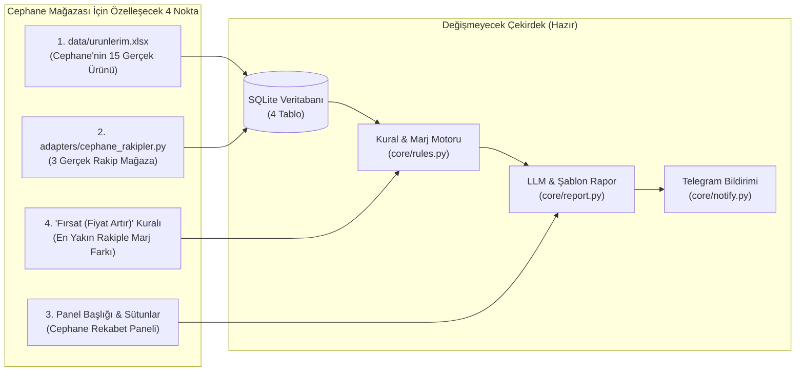

# 🎯 Cephane Mağazası Özel Demo, Teknik Mimari ve Satış Kılavuzu

> **Amaç:** Cephane Mağazası Satın Alma Müdürü **Serdar Bey** ile başlayan görüşmeyi, onların gerçek ürünleri ve gerçek rakipleriyle çalışan **etkileyici bir özel demoya** dönüştürmek, teknik/mimari tüm soru işaretlerini gidermek ve **ilk ücretli müşteri satışını** başarıyla kapatmak.

---

## 📌 İçindekiler
1. [Stratejik Analiz: Bir Satın Alma Müdürü Gerçekte Neye Para Verir?](#1-stratejik-analiz-bir-satın-alma-müdürü-gerçekte-neye-para-verir)
2. [İki Senaryolu Eylem Planı (Yanıt Gelirse vs. Yanıt Gecikirse)](#2-iki-senaryolu-eylem-planı-yanıt-gelirse-vs-yanıt-gecikirse)
3. [Teknik Uyarlama: Mevcut Sistemimizi Cephane Mağazası'na Nasıl Uyarlayacağız?](#3-teknik-uyarlama-mevcut-sistemimizi-cephane-mağazasına-nasıl-uyarlayacağız)
4. [Akakçe ve Rakip Sitelerden Veri Çekme (Scraping) Stratejisi](#4-akakçe-ve-rakip-sitelerden-veri-çekme-scraping-stratejisi)
5. [7/24 Çalışma Mimarisi, Sunucu (VPS) Seçimi ve Maliyetler](#5-724-çalışma-mimarisi-sunucu-vps-seçimi-ve-maliyetler)
6. [İşi Alacak "Kusursuz Demo"da Olması Gereken 5 Vurucu Detay](#6-işi-alacak-kusursuz-demoda-olması-gereken-5-vurucu-detay)
7. [Demo Teslim Mesajı ve 15 Dakikalık Toplantı Senaryosu](#7-demo-teslim-mesajı-ve-15-dakikalık-toplantı-senaryosu)
8. [Fiyatlandırma Stratejisi ve Zor Sorulara Profesyonel Cevaplar](#8-fiyatlandırma-stratejisi-ve-zor-sorulara-profesyonel-cevaplar)

---

## 1. Stratejik Analiz: Bir Satın Alma Müdürü Gerçekte Neye Para Verir?

Cephane Mağazası'nı **Akakçe** üzerinde buldun ve dönüş yapan kişi **Satın Alma Müdürü (Serdar Bey)**. Bu çok kritik bir avantajdır çünkü:

1. **Akakçe Satıcısının En Büyük Derdi "Sıralama (En Ucuz Olma)"dır:**
   Akakçe'de müşteriler fiyata göre sıralanmış listeye bakar. Bir rakip fiyatı sadece **5 TL** bile düşürse, listede 1. sıradan 4. sıraya düşersin ve o günkü satışın bıçak gibi kesilir.
2. **İkinci Büyük Dert "Gereksiz Yere Ucuza Satmak (Marj Kaybı)"dır:**
   Bazen en yakın rakibin stoğu biter veya rakip fiyatını 1.200 TL'ye çıkarır; ama senin mağazan hâlâ 1.000 TL'den satmaya devam eder. Aradaki **200 TL saf kârı** haberi olmadığı için masada bırakır.
3. **Satın Alma Müdürü Neden İlgilendi?**
   Satın alma müdürü hem tedarik maliyetini bilir hem de hangi üründe ne kadar indirim yapılabileceğine karar verir. Senin sistemin ona **"Hangi üründe fiyat kırmalıyız, hangisinde fiyat artırabiliriz ve hangi üründe rakip maliyetin bile altına inmiş (zararına satıyor)?"** sorusunun cevabını her sabah hazır veriyor.

> [!IMPORTANT]
> **Altın Kural:** Serdar Bey teknik terimlerle (`FastAPI`, `SQLAlchemy`, `rapidfuzz`, `LLM`) hiç ilgilenmez. O sadece ekranda **kendi sattığı gerçek ürünleri**, **kendi gerçek rakiplerini** ve **doğru hesaplanmış TL farklarını** görmek ister.

---

## 2. İki Senaryolu Eylem Planı (Yanıt Gelirse vs. Yanıt Gecikirse)

Serdar Bey'e 3 soruluk çok doğru bir mesaj attın. Şimdi önümüzde iki olasılık var:

### 🟢 Senaryo A: Serdar Bey 10–15 Ürün ve Rakip Listesini Gönderirse
1. Gönderdiği 10–15 ürünü ve rakipleri alacağız.
2. *"Teşekkürler Serdar Bey, listeyi aldım. Çarşamba/Perşembe günü sizin ürünlerinizle çalışan canlı tabloyu ve sabah raporunu paylaşacağım."* diye kısa bir teyit mesajı döneceğiz.
3. Aşağıdaki **Bölüm 3**'teki adımlarla 1–2 gün içinde sistemi onların verisiyle dolduracağız.

### 🟡 Senaryo B: Serdar Bey 48 Saat İçinde Yanıt Vermezse ("Proaktif Demo" Taktiği)
Şirketlerde satın alma müdürleri çok yoğundur; Excel hazırlamaya üşenebilir veya unutabilirler. **Asla boş beklemeyeceğiz!**
1. Akakçe'ye girip **Cephane Mağazası'nın profilinden** en çok bilinen / en rekabetçi **10–12 ürününü** biz kendimiz seçeceğiz.
2. Yine Akakçe'de o 10–12 üründe Cephane Mağazası ile yarışan **en sıkı 3 rakip mağazayı** belirleyeceğiz.
3. Demoyu bu gerçek verilerle hazırlayıp Serdar Bey'e şu mesajı atacağız:
   > *"Merhaba Serdar Bey, yoğunluğunuzda vaktinizi almamak için Akakçe'deki mağazanızdan 12 popüler ürününüzü ve aynı ürünleri satan 3 rakibinizi sisteme tanımlayıp size özel demoyu hazırladım. Şu an 12 ürünün 8'inde rakiplerin fiyat farklarını ve marj önerilerini görebilirsiniz..."*
   *(Bu hamle, yanıt vermeyen müşterilerin bile %70'ini toplantıya çeker çünkü ortada hazır çalışan bir iş vardır).*

---

## 3. Teknik Uyarlama: Mevcut Sistemimizi Cephane Mağazası'na Nasıl Uyarlayacağız?

Mevcut projemiz (`fiyat-takip-sistemi`) modüler olduğu için çekirdek mimariye (`core/db.py`, `core/models.py`, `api/main.py`) neredeyse hiç dokunmadan sadece **veri ve adaptör** katmanını özelleştireceğiz:



### Yapılacak 4 Somut Uyarlama:

#### 1. `data/urunlerim.xlsx` (Gerçek Ürün Kataloğu)
Kitap ve tabletleri silip Cephane Mağazası'nın 10–15 ürününü gireceğiz:
- `sku`: Ürün model kodu veya barkodu
- `urun_adi`: Ürünün tam adı ve modeli
- `fiyat`: Cephane Mağazası'nın güncel satış fiyatı (TL)
- `maliyet`: Eğer Serdar Bey gerçek maliyeti verirse onu yazarız; vermezse satış fiyatının `%75`'ini örnek maliyet, `%15`'ini örnek minimum marj olarak gireriz (ve görüşmede *"Maliyetleri örnek girdik, kendi gerçek maliyetlerinizi Excel'de değiştirdiğiniz an öneriler güncellenir"* deriz).

> [!TIP]
> **Müşteriyi Etkileyecek Sürpriz Özellik (XML Entegrasyonu):**
> Cephane Mağazası Akakçe'de satış yaptığı için zaten bir **Akakçe XML Ürün Beslemesi (XML Feed)** linkine sahiptir. Görüşmede Serdar Bey'e şunu söyleyeceksin:
> *"Serdar Bey, demoyu Excel ile kurduk ama isterseniz Akakçe'ye verdiğiniz XML linkinizi sisteme bağlayabiliriz; böylece Excel bile yüklemezsiniz, kendi fiyat ve stoklarınız da sistemde otomatik güncellenir."*

#### 2. Eşleştirmeleri Demoda %100 Kesin Yapmak (`matches` Tablosu)
Demoda sadece 10–15 ürün olacağı için:
- `rapidfuzz` eşleştirme motorunu yine çalıştıracağız (`Eşleşme Onayı` ekranında Serdar Bey'e göstermek için 2 tane `%80` skorlu ürünü "Onay Bekliyor" bırakacağız ki o ekranın değerini görsün).
- Geri kalan ürünlerin rakip karşılıklarını birebir doğrulayacağız; böylece demoda Serdar Bey tabloya baktığında **tek bir hatalı ürün eşleşmesi bile görmeyecek**.

#### 3. Satın Alma Müdürünü Kalbinden Vuracak Ek Kural: "Fırsat Uyarısı (Gereksiz Ucuzluk)"
Mevcut kural motorumuzda (`core/rules.py`) şu 4 kural var:
- `RAKIP_UCUZ`: Rakip bizden ucuz.
- `FIYAT_DUSTU`: Rakip fiyatını `%5+` indirdi.
- `STOK_BITTI`: Rakipte stok bitti (Fiyatı koru/artır fırsatı).
- `ONERI`: Marjı bozmadan rakibin `%1` altına inme önerisi.

Cephane Mağazası demosunda buna 5 satırlık bir **"FIRSAT: FİYAT ARTIRABİLİRSİN"** uyarısı ekleyebiliriz:
- **Senaryo:** Cephane Mağazası ürünü `1.000 TL`'ye satıyor (1. sırada). En yakın rakip ise `1.180 TL`'ye satıyor.
- **Sistemin Önerisi:** *"Zaten en ucuz satıcısınız ancak en yakın rakiple aranızda 180 TL (%18) fark var. Fiyatınızı **1.165 TL**'ye yükselterek 1. sırayı kaybetmeden ürün başına **+165 TL ekstra kâr** elde edebilirsiniz."*
- **Etkisi:** Bir satın alma müdürü bu cümleyi gördüğünde sistemin kendi maliyetini birkaç günde çıkaracağını anında hesaplar.

#### 4. Panel Başlığı ve Marka Uyarlaması (`index.html`)
- Web panelinin sol üst başlığını **"Cephane Mağazası — Fiyat Takip ve Rekabet Paneli"** yapacağız.
- Tablodaki `Rakip A (BooksToScrape)`, `Rakip B (WebScraper)` sütun başlıklarını Serdar Bey'in gerçek rakiplerinin isimleriyle (ör. `Rakip 1 (X Mağazası)`, `Rakip 2 (Y Mağazası)`, `Akakçe En Ucuz`) değiştireceğiz.

---

## 4. Akakçe ve Rakip Sitelerden Veri Çekme (Scraping) Stratejisi

*"Akakçe gibi yerlerden ürünleri çekebilmem mümkün mü, site buna izin verecek mi?"* sorunun tam teknik yanıtı ve çözüm haritası şöyledir:

### Durum 1: Rakip Mağazaların Kendi Web Siteleri (En Kolay ve Ücretsiz Yol)
Akakçe'de Cephane Mağazası ile rekabet eden satıcıların büyük çoğunluğunun kendi e-ticaret sitesi vardır (**İkas, Ticimax, Ideasoft, T-Soft, Shopify, WooCommerce** altyapıları).
- **Site izin verir mi?** Günde sadece 1 veya 2 kez, 15–50 ürün sayfasına normal bir ziyaretçi gibi (istekler arası 2–3 saniye bekleyerek) girdiğinde bu siteler **hiçbir engel çıkarmaz**.
- **Nasıl çekilir?** Bu altyapıların neredeyse tamamında sayfa kaynağında `<script type="application/ld+json">` (Google Rich Snippets / Schema.org Product) etiketi bulunur. HTML tasarımı değişse bile bu JSON bloğunun içindeki `price` ve `availability` (stok durumu) alanı hep sabit kalır! Mevcut `httpx` + `BeautifulSoup4` yapımızla doğrudan çekilir.

### Durum 2: Doğrudan Akakçe / Cimri Ürün Sayfaları (Cloudflare Korumalı Siteler)
Bir ürünün Akakçe sayfasında (ör. `akakce.com/...fiyati,12345.html`) o ürünü satan **tüm mağazaların fiyatları alt alta** listelenir. Bu harika bir veridir çünkü **tek bir sayfadan 10 rakibin fiyatını aynı anda** alabilirsin!
- **Engel nedir?** Akakçe'de **Cloudflare** bot koruması vardır. Standart `httpx.get()` ile istek atarsan Cloudflare bunu bot olarak algılar ve `403 Forbidden` (veya "İnsan olduğunuzu doğrulayın" ekranı) döndürür.
- **Bu Engel Nasıl Aşılır? (3 Profesyonel Yöntem):**

| Yöntem | Ne Zaman Kullanılır? | Nasıl Çalışır? | Maliyet |
| :--- | :--- | :--- | :--- |
| **1. Rakip Mağazaların Kendi Sitelerini Çekmek** | Müşterinin belirli 3–5 ana rakibi varsa | Akakçe yerine doğrudan o 3–5 mağazanın kendi sitesindeki ürün linkleri çekilir. | **0 TL (Ücretsiz)** |
| **2. Gerçek Tarayıcı Oturumu (Playwright / Camoufox / nodriver)** | Demoda ve 15–50 ürünlük günlük takiplerde | Bilgisayarımızdaki gerçek tarayıcı profiliyle sayfayı açıp fiyatları okuruz; istekler arası 4–6 sn beklenir. | **0 TL (Ücretsiz)** |
| **3. Scraping API Servisi (ZenRows / ScraperAPI / Crawlbase)** | 7/24 Bulut Sunucuda (VPS) yüzlerce ürün çekilecekse | Sunucudan doğrudan Akakçe'ye değil, `ScraperAPI` veya `ZenRows` servisine istek atılır; Cloudflare'i onlar geçip temiz HTML'i bize verir. | Demo için **Ücretsiz** (1.000 istek hediye). Canlıda aylık **15$–29$** *(Müşteri faturasına eklenir)*. |

> [!NOTE]
> **Özetle:** 10–15 ürünlük Cephane Mağazası demosunu hazırlarken **sıfır maliyetle** hem rakiplerin kendi sitelerinden hem de gerekirse Akakçe ürün sayfasından veriyi rahatlıkla çekebiliriz. İşi alıp 7/24 sunucuya geçtiğimizde ise ürün sayısına göre ya doğrudan rakip siteleri izleriz ya da aylık sunucu bakım ücretinin içine 15$'lık bir API/Proxy servisi dahil ederiz.

---

## 5. 7/24 Çalışma Mimarisi, Sunucu (VPS) Seçimi ve Maliyetler

*"Ben bir fiyat takip sistemi yaptığımda bu sistem 7/24 çalışacak değil mi? Nerede çalışacak? Web uygulaması olarak mı yapmam gerekecek?"*

### 1. Evet, Sistem Zaten Bir Web Uygulaması!
Şu an geliştirdiğimiz FastAPI uygulaması (`api/main.py`) ve zamanlayıcı (`scheduler.py`) zaten **tam teşekküllü bir web uygulaması ve arka plan servisidir**. Bilgisayarın kapandığında durmaması için, satış gerçekleştiğinde bu kodu **7/24 açık duran bir Bulut Sunucuya (VPS - Virtual Private Server)** yükleyeceğiz.

### 2. Demo Aşamasında vs. Satış Sonrasında Nerede Çalışacak?

#### A) Demo Aşamasında (Şu An — Maliyet: 0 TL)
Serdar Bey işi onaylayana kadar sunucu kiralamana **gerek yoktur**.
- Sistemi kendi bilgisayarında çalıştıracaksın.
- Serdar Bey'e paneli canlı göstermek istediğinde bilgisayarında **Cloudflare Tunnel (`cloudflared`)** komutunu çalıştıracağız:
  ```bash
  cloudflared tunnel --url http://127.0.0.1:8000
  ```
- Bu komut sana saniyeler içinde `https://cephane-fiyat-demo.trycloudflare.com` gibi güvenli (`https`) bir internet adresi verir. Serdar Bey kendi bilgisayarından veya cep telefonundan bu linke tıkladığında senin bilgisayarında çalışan paneli canlı olarak kullanabilir!

#### B) İşi Aldıktan Sonra (7/24 Canlı Sistem — Aylık Maliyet: ~180 TL)
Serdar Bey *"Tamam Özenç Bey, kuralım"* dediğinde sistemi 15 dakika içinde bir bulut sunucuya taşıyacağız:

| Sağlayıcı | Önerilen Paket | Özellikler | Aylık Maliyet | Neden Tercih Edilir? |
| :--- | :--- | :--- | :---: | :--- |
| **Hetzner Cloud** *(Önerilen)* | `CX22` (Ubuntu 24.04) | 2 vCPU, 4 GB RAM, 40 GB SSD | **~4.5 € (~170 TL)** | Çok hızlıdır, tek sunucuda 5–10 farklı müşterinin sistemini bile aynı anda çalıştırabilirsin. |
| **DigitalOcean** | Basic Droplet | 1 vCPU, 1–2 GB RAM | **6 $ (~200 TL)** | Kurulumu çok basittir, arayüzü anlaşılırdır. |
| **Railway.app / Render** | Hobby Plan | GitHub'dan otomatik kurulum | **5 $ (~170 TL)** | Sunucu yönetimiyle (Linux komutlarıyla) hiç uğraşmadan doğrudan GitHub reposunu bağlayıp 7/24 çalıştırır. |

### 3. Sunucuda 7/24 Nasıl Çalışacak?
Sunucuda iki küçük servis (`systemd` veya `Docker Compose` ile) sürekli açık kalacak:
1. **`fiyat-takip-web` servisi:** `uvicorn api.main:app --host 0.0.0.0 --port 8000` komutunu 7/24 çalıştırır. Serdar Bey günün hangi saati girerse girsin panel açılır.
2. **`fiyat-takip-scheduler` servisi:** `python scheduler.py` komutunu 7/24 çalıştırır. Her sabah saat `09:00`'da (veya müşterinin istediği saatlerde, örn. `08:30` ve `14:00`) fiyatları çeker, kuralları hesaplar ve **Serdar Bey'in Telegram'ına** raporu gönderir.
3. **Şifre Koruması:** Canlıya geçerken FastAPI'ye 15 satırlık bir **Kullanıcı Adı / Şifre (`HTTPBasicAuth`)** ekleyeceğiz. Böylece panele sadece Serdar Bey ve ekibi kendi şifreleriyle girebilecek.

---

## 6. İşi Alacak "Kusursuz Demo"da Olması Gereken 5 Vurucu Detay

Serdar Bey'e demoyu sunduğumuzda *"Bu tam bizim ihtiyacımız olan şey, hemen başlayalım"* demesini sağlayacak **5 kritik unsur** şunlardır:

1. **Gerçek Ürün ve Gerçek Rakip İsimleri:**
   Tabloda hayali ürünler değil, Cephane Mağazası'nın sattığı **en az 10–15 gerçek ürün** ve **gerçek rakipleri** yer almalı.
2. **En Az 2–3 Üründe Somut Bulgular ("Aha!" Anı):**
   Demoyu gönderirken mesajın içinde doğrudan gerçek bir bulguyu söylemelisin. Örneğin:
   *"Serdar Bey, gönderdiğiniz 12 ürünü sisteme yükledim. Şu an X ürününde Y mağazası sizden 65 TL daha ucuz görünüyor; Z ürününde ise rakiplerin stoğu bitmiş, fiyat artırma fırsatınız var."*
3. **Marj Korumalı Dip Fiyat Hesabı:**
   Satın alma müdürleri zararına satıştan nefret eder. Panelde *"Dip Fiyatınız (Maliyet + %15 Marj): 1.150 TL — Rakip 1.120 TL'ye inmiş, marjı bozmadan rekabet edilemez"* uyarısını görmek Serdar Bey'e büyük güven verir.
4. **Canlı Telegram Testi (Kendi Telefonuna Düşmesi):**
   Görüşme sırasında Serdar Bey'e *"Telegram'da `@fatura_takip_bot` (veya yeni açacağımız `@cephane_fiyat_bot`) botuna `/start` yazın"* deyip, komutu çalıştırdığın anda **onun kendi cep telefonuna** sabah brifinginin düşmesini sağlamak satışı o saniyede kapatır.
5. **14 Günlük Fiyat Geçmişi Grafiği:**
   Bir ürüne tıkladığında son 2 haftada hangi rakibin ne zaman fiyat kırdığını çizgi grafikte görmesi, raporlama açısından onu çok etkileyecektir.

---

## 7. Demo Teslim Mesajı ve 15 Dakikalık Toplantı Senaryosu

### A) Demoyu Hazırladıktan Sonra Serdar Bey'e Göndereceğimiz Mesaj Şablonu

> **Konu:** Cephane Mağazası Ürünleriniz İçin Hazırlanan Fiyat Takip Demosu
>
> Merhaba Serdar Bey,
>
> Sizin ürünleriniz ve rakip mağazalarınızla çalışan özel fiyat takip sistemini hazırladım.
>
> İlk tarama sonuçlarına göre dikkat çeken birkaç bulgu:
> - İncelenen **[X]** ürününüzün **[Y]** tanesinde rakipler şu an daha düşük fiyat veriyor.
> - Özellikle **"[Örnek Ürün Adı 1]"** ürününde **[Rakip Mağaza Adı]**, sizin fiyatınızın **[Fark] TL** altında satıyor.
> - **"[Örnek Ürün Adı 2]"** ürününde ise en ucuz satıcı sizsiniz ve en yakın rakiple aranızda **[Fark] TL** marj artırma fırsatı bulunuyor.
>
> Sistemin sizin ürünlerinizle nasıl çalıştığını gösteren **1.5 dakikalık ekran videosunu** buradan izleyebilirsiniz: **[Video Linki]**
>
> Yarın veya Perşembe günü **10-15 dakikalık kısa bir görüntülü görüşmede** canlı paneli birlikte inceleyip sabah özetini doğrudan sizin telefonunuza düşürebiliriz. Saat **11:00** veya **15:00** sizin için uygun olur mu?
>
> İyi çalışmalar,
> **Özenç**
> 0543 167 6351

---

### B) 15 Dakikalık Canlı Görüşme (Google Meet / Zoom) Akışı

Görüşmede zamanı şöyle yöneteceksin:
1. **İlk 3 Dakika — Dinleme (Kılavuzdaki 5 Altın Soru):**
   Hemen ekran paylaşma! Önce şu soruları sorup Serdar Bey'i konuştur:
   - *"Serdar Bey, şu an kaç ürünün fiyatını düzenli takip ediyorsunuz?"*
   - *"Bu takibi kim yapıyor ve günde kaç saatini alıyor?"*
   - *"Rakip fiyat kırdığında bunu geç fark etmek size haftalık/aylık ne kadar satış kaybettiriyor?"*
2. **3. – 10. Dakika — Canlı Panel ve Telegram Gösterimi:**
   - Ekranını paylaş, kendi ürünlerinin olduğu kırmızı/yeşil tabloyu göster.
   - *"Sadece rakibin ucuz olduğu ürünler"* filtresine tıkla.
   - Bir ürünün detayına girip 14 günlük grafiği ve marj korumalı fiyat önerisini göster.
   - Telegram'a gelen sabah brifingini göster.
3. **10. – 15. Dakika — Uyarlama ve Teklif:**
   - *"Serdar Bey, bu sistemi sizin tüm öncelikli ürünlerinize (örneğin 100–250 ürün) ve takip ettiğiniz rakiplere göre 3 iş günü içinde canlıya alıp, her sabah 09:00'da sizin ve ekibinizin telefonuna rapor gönderecek şekilde teslim edebilirim."*

---

## 8. Fiyatlandırma Stratejisi ve Zor Sorulara Profesyonel Cevaplar

### 💰 Önerilen Fiyatlandırma Modeli (Kurulum + Aylık Bakım)

İlk müşterin olduğu için referans kazanmak adına makul ama emeğinin karşılığını veren **iki aşamalı** bir fiyat sunmak en doğrusudur:

1. **Tek Seferlik Kurulum ve Uyarlama Ücreti (Örn: `7.500 TL – 15.000 TL` arası, ürün ve rakip sayısına göre):**
   - Kendi ürün kataloglarının (Excel veya XML) sisteme bağlanması
   - İstedikleri rakip sitelerin / kaynakların adaptörlerinin yazılması
   - İlk ürün eşleştirmelerinin yapılması
   - Şirkete özel şifreli Web Paneli ve Telegram Bot kurulumu
2. **Aylık Sunucu, Takip ve Bakım Ücreti (Örn: `1.500 TL – 3.000 TL / ay`):**
   - 7/24 Bulut Sunucu (VPS) ve veritabanı yedekleme maliyeti *(Senin gerçek maliyetin sadece ~200 TL)*
   - Günlük otomatik fiyat taraması ve sabah Telegram brifingi
   - **Bakım Garantisi:** Rakip sitelerden biri web tasarımını değiştirirse adaptörün ücretsiz güncellenmesi

---

### 🛡️ Serdar Bey'in Sorabileceği Zor Sorular ve Hazır Cevapların

#### Soru 1: *"Bizim 500 (veya 2.000) ürünümüz var, hepsini takip edebilir mi?"*
> **Cevabın:** *"Evet, sistemin veritabanı ve mimarisi binlerce ürünü destekliyor. Ancak en yüksek verimi almak için ilk aşamada cironuzun %80'ini oluşturan en kritik **50–100 ana ürünle** başlıyoruz, eşleştirmeleri doğruladıktan sonra kalan kategorileri kademeli olarak ekliyoruz."*

#### Soru 2: *"Günde sadece 1 kez mi bakıyor? Günde birkaç kez bakamaz mı?"*
> **Cevabın:** *"Zamanlayıcı tamamen ayarlanabilir durumda. İsterseniz sadece sabah 09:00'da değil; **sabah 09:00, öğle 13:00 ve akşam 17:00** olmak üzere günde 3 kez tarama yapıp acil fiyat düşüşlerinde anlık Telegram uyarısı gönderecek şekilde ayarlayabiliriz."*

#### Soru 3: *"Önerilen fiyatları bizim e-ticaret sitemizde otomatik olarak da güncelleyebilir mi?"*
> **Cevabın:** *"Teknik olarak e-ticaret altyapınızın (Ticimax, İkas, Ideasoft vb.) API'si üzerinden otomatik fiyat güncellemesi yapılabilir. Ancak güvenlik ve kârlılık açısından ilk 1 ay sistemin önerilerini Telegram ve panel üzerinden **sizin onayınızla** uygulamanızı öneriyoruz; kurallardan %100 emin olduğunuzda ikinci faz olarak otomatik fiyat güncellemesini de bağlayabiliriz."*

#### Soru 4: *"Rakip siteler fiyat çekmemizi engellerse ne olur?"*
> **Cevabın:** *"Sistemimiz siteleri yoracak şekilde saniyede yüzlerce istek atmıyor; normal bir kullanıcı hızında yalnızca sizin seçtiğiniz ürünlere bakıyor. Ayrıca korumalı siteler için proxy/aracı veri katmanı kullanıyoruz ve bir sitede yapısal değişiklik olduğunda sistem bana otomatik uyarı veriyor, aynı gün içinde adaptörü güncelliyorum."*

---

## ✅ Şimdi Sıradaki Adım Ne?

1. **Bugün:** Serdar Bey'in e-postasına/mesajına yanıt vermesini bekliyoruz.
2. **Serdar Bey'den ürün/rakip listesi geldiği anda** (veya yarın akşama kadar gelmezse Akakçe'den Cephane Mağazası'nın 12 ürününü birlikte seçerek) bana haber veriyorsun.
3. Birlikte birkaç saat içinde `data/urunlerim.xlsx` ve rakip adaptörlerini Cephane Mağazası'na göre doldurup, **Serdar Bey'e özel canlı paneli ve videosunu** çıkarıyoruz!

